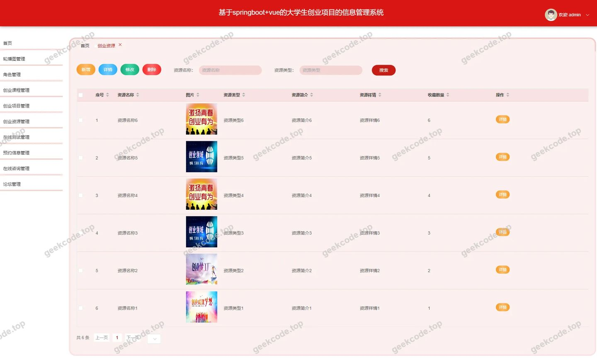
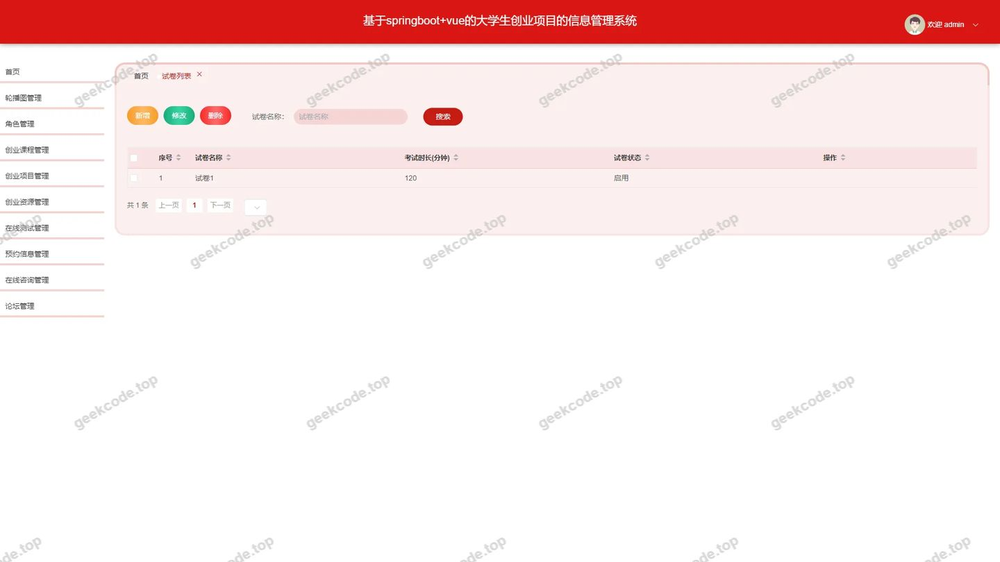
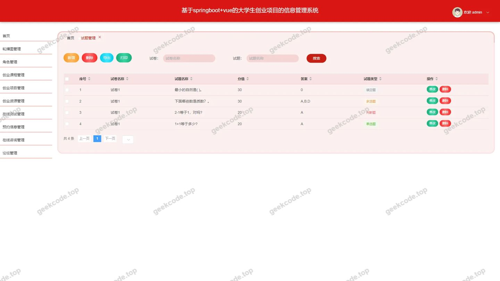
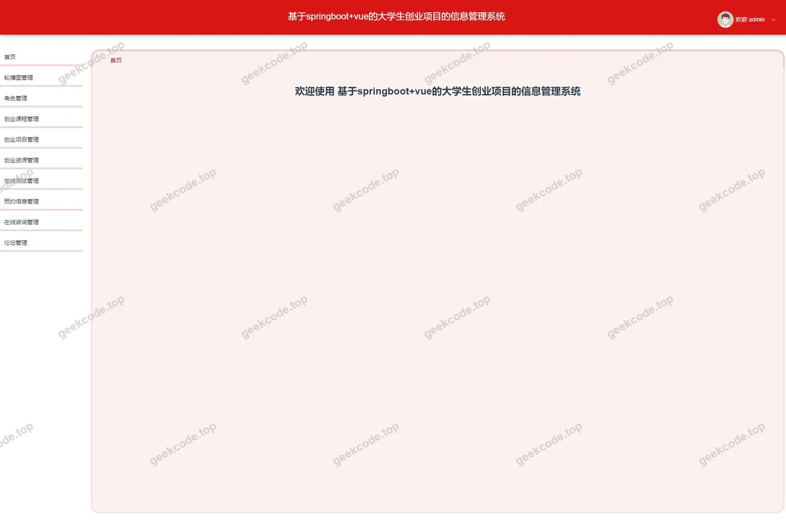
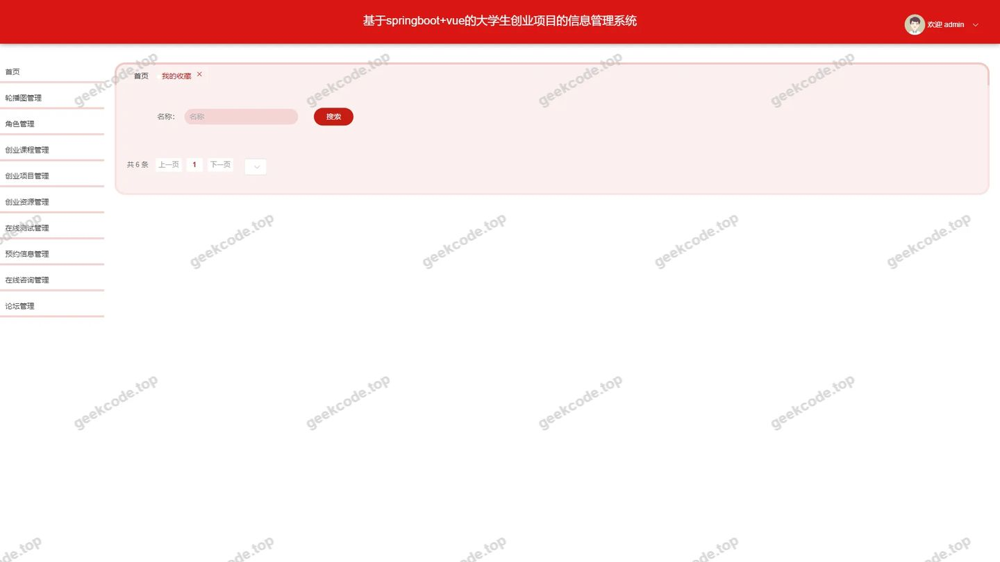
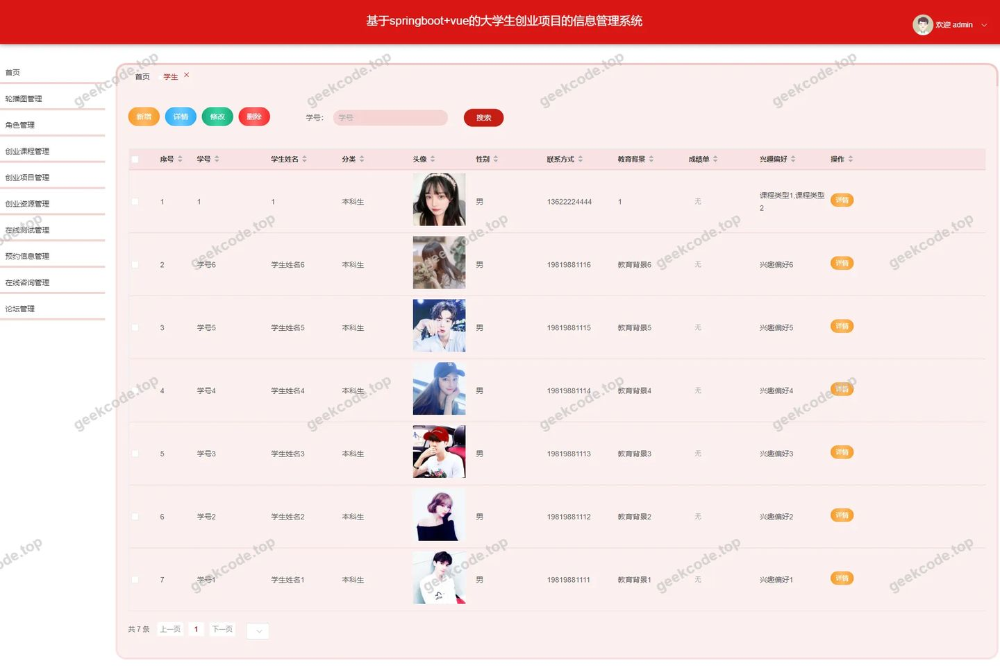
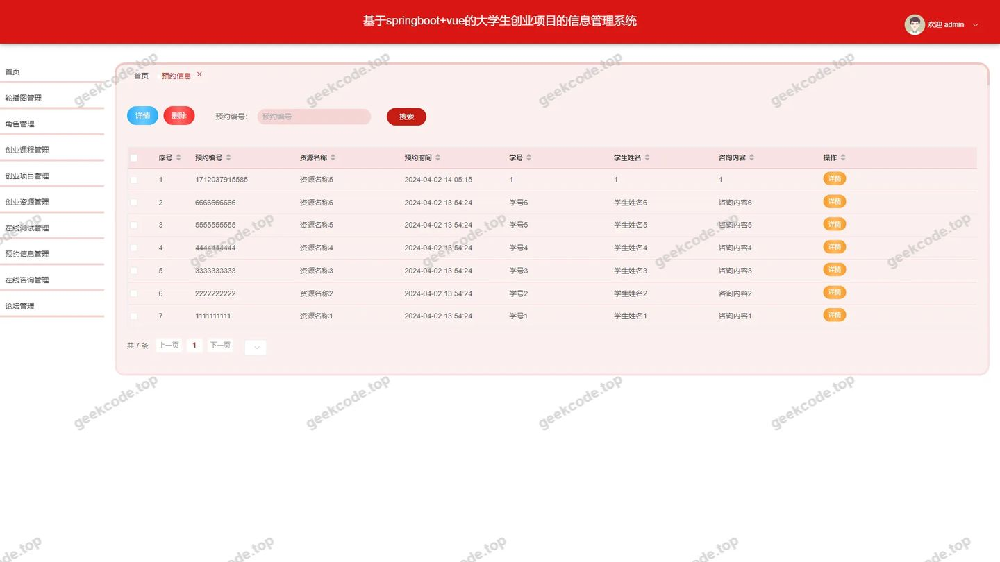

# [springboot]基于springboot+vue的大学生创业项目的信息管理系统

> 🎓 **计算机毕业设计 · [springboot]基于springboot+vue的大学生创业项目的信息管理系统**
>
> 本仓库只放**项目介绍 + 运行截图**（截图是站点带水印的原图，存在仓库 `images/` 里）。
>
> 👉 **完整可运行源码 / 数据库脚本 / 部署文档：[点我获取](https://geekcode.top/archives/springboot-%E5%9F%BA%E4%BA%8Espringboot-vue%E7%9A%84%E5%A4%A7%E5%AD%A6%E7%94%9F%E5%88%9B%E4%B8%9A%E9%A1%B9%E7%9B%AE%E7%9A%84%E4%BF%A1%E6%81%AF%E7%AE%A1%E7%90%86%E7%B3%BB%E7%BB%9F?utm_source=github)**
>
> 💬 咨询微信：**ir9372**　|　🌐 更多项目：[极客代码 geekcode.top](https://geekcode.top/?utm_source=github)
>
> 📌 项目详情页：<https://geekcode.top/archives/springboot-%E5%9F%BA%E4%BA%8Espringboot-vue%E7%9A%84%E5%A4%A7%E5%AD%A6%E7%94%9F%E5%88%9B%E4%B8%9A%E9%A1%B9%E7%9B%AE%E7%9A%84%E4%BF%A1%E6%81%AF%E7%AE%A1%E7%90%86%E7%B3%BB%E7%BB%9F?utm_source=github>

<table><td width="230" align="center"> <b>扫码加微信 ir9372</b></td><td valign="middle">📦 源码 = 项目介绍 + 全部运行截图 + 数据库 + 部署文档 👉 点上方任意截图，直接跳到 <b>极客代码 geekcode.top</b> 详情页</td></table>

---

<h1>[springboot]基于springboot+vue的大学生创业项目的信息管理系统</h1>
<h2>项目概述</h2>

本项目名为“基于Spring Boot+Vue的大学生创业项目的信息管理系统”，旨在为高校学生提供一个集创业资源获取、课程学习、项目管理及在线考试于一体的综合性服务平台。系统核心功能涵盖学生注册与信息管理、创业项目发布与浏览、创业资源展示、创业课程学习、论坛交流、预约服务以及在线考试与成绩记录等模块。适用人群主要为在校大学生（作为前台用户）和学校管理人员或教师（作为后台管理员）。技术架构采用前后端分离模式，后端基于Spring Boot框架，集成MyBatis-Plus进行数据持久化，使用Shiro实现权限控制；前端采用Vue.js构建响应式界面。该系统有效解决了传统创业教育中信息分散、管理效率低下的问题，提升了大学生创业实践的数字化水平。

<h2>技术架构</h2>
<h3>1. 总体架构</h3>

系统采用经典的前后端分离架构：

<ul>
<li><strong>后端</strong>：基于 Spring Boot 框搭建RESTful API服务，利用 <code>spring-boot-starter-web</code> 提供Web支持，通过 <code>mybatis-spring-boot-starter</code> 和 <code>mybatis-plus</code> 简化数据库操作，使用 <code>mysql-connector-java</code> 连接 MySQL 数据库。安全方面引入 <code>shiro-spring</code> 实现身份认证与授权管理。</li>
<li><strong>前端</strong>：基于 Vue.js 框架开发，分为前台用户端和后台管理端两个独立的应用入口，通过 HTTP 请求与后端接口交互。</li>
</ul>
<h3>2. 核心技术选型理由</h3>
<ul>
<li><strong>Spring Boot</strong>：简化配置，快速启动，生态丰富，适合构建企业级Java应用。</li>
<li><strong>MyBatis-Plus</strong>：在MyBatis基础上增强CRUD操作，减少样板代码，提高开发效率。</li>
<li><strong>Apache Shiro</strong>：轻量级且强大的安全框架，提供清晰的权限模型，适用于本系统的多角色访问控制需求。</li>
<li><strong>MySQL</strong>：主流开源关系型数据库，稳定可靠，满足中小规模数据存储需求。</li>
</ul>
<h3>3. 数据库设计要点</h3>

根据路由和功能推断，数据库主要包含以下实体表：

<ul>
<li><strong>用户类</strong>：<code>users</code>（管理员/普通用户）、<code>xuesheng</code>（学生详细信息）。</li>
<li><strong>业务类</strong>：<code>chuangyexiangmu</code>（创业项目）、<code>xiangmuleixing</code>（项目类型）、<code>chuangyeziyuan</code>（创业资源）、<code>chuangyekecheng</code>（创业课程）、<code>kechengleixing</code>（课程类型）。</li>
<li><strong>互动与服务类</strong>：<code>forum</code>（论坛帖子）、<code>storeup</code>（收藏记录）、<code>yuyuexinxi</code>（预约信息）、<code>chat</code>（聊天消息）。</li>
<li><strong>考试类</strong>：<code>exampaper</code>（试卷）、<code>examquestion</code>（试题）、<code>examrecord</code>（考试记录）、<code>examfailrecord</code>（不及格记录）。</li>
<li><strong>配置类</strong>：<code>config</code>（系统参数配置）。</li>
</ul>
<h2>功能模块</h2>
<h3>前台用户端功能</h3>

前台面向注册的学生用户，提供创业学习与互动服务：

<ol>
<li><strong>首页展示</strong>：聚合显示最新创业项目、热门课程及资源推荐。</li>
<li><strong>用户中心</strong>：<ul>
<li><strong>学生注册/登录</strong>：新用户需填写个人信息完成注册。</li>
<li><strong>个人中心</strong>：查看和修改个人资料。</li>
<li><strong>我的收藏</strong>：查看已收藏的创业项目、课程等资源。</li>
</ul>
</li>
<li><strong>创业项目模块</strong>：<ul>
<li><strong>项目列表/详情</strong>：浏览各类创业项目，查看具体介绍。</li>
<li><strong>项目发布</strong>：学生可提交新的创业项目信息。</li>
<li><strong>项目类型筛选</strong>：按类别查看特定类型的创业项目。</li>
</ul>
</li>
<li><strong>创业资源模块</strong>：<ul>
<li><strong>资源列表/详情</strong>：浏览政策、资金、场地等创业相关资源。</li>
<li><strong>资源发布</strong>：上传或分享创业资源信息。</li>
</ul>
</li>
<li><strong>创业课程模块</strong>：<ul>
<li><strong>课程列表/详情</strong>：查看线上创业培训课程。</li>
<li><strong>课程类型筛选</strong>：按学科或方向分类浏览课程。</li>
</ul>
</li>
<li><strong>论坛社区</strong>：<ul>
<li><strong>论坛列表</strong>：参与话题讨论，查看帖子详情。</li>
</ul>
</li>
<li><strong>预约服务</strong>：<ul>
<li><strong>预约信息列表/详情</strong>：查看导师指导或场地预约情况。</li>
<li><strong>发起预约</strong>：提交预约申请。</li>
</ul>
</li>
<li><strong>在线考试系统</strong>：<ul>
<li><strong>试卷列表</strong>：选择可用的考试试卷。</li>
<li><strong>开始考试</strong>：进入答题界面 (<code>/examination</code>)。</li>
<li><strong>考试记录</strong>：查看历史考试成绩 (<code>/examrecordList</code>)。</li>
<li><strong>失败记录</strong>：查看未通过的考试记录 (<code>/examfailrecord</code>)。</li>
</ul>
</li>
</ol>
<h3>后台管理端功能</h3>

后台面向管理员，负责全系统的数据维护与审核：

<ol>
<li><strong>系统管理</strong>：<ul>
<li><strong>登录页</strong>：管理员身份验证入口。</li>
<li><strong>首页仪表盘</strong>：概览系统关键指标。</li>
<li><strong>配置管理</strong>：维护系统基础参数 (<code>/config</code>)。</li>
<li><strong>用户管理</strong>：管理管理员账号 (<code>/users</code>)。</li>
</ul>
</li>
<li><strong>学生管理</strong>：<ul>
<li><strong>学生列表</strong>：查看所有注册学生信息 (<code>/xuesheng</code>)，支持增删改查。</li>
</ul>
</li>
<li><strong>内容管理</strong>：<ul>
<li><strong>创业项目管理</strong>：审核、编辑或删除学生提交的创业项目 (<code>/chuangyexiangmu</code>)。</li>
<li><strong>项目类型管理</strong>：维护创业项目的分类标签 (<code>/xiangmuleixing</code>)。</li>
<li><strong>创业资源管理</strong>：发布官方资源或审核用户上传资源 (<code>/chuangyeziyuan</code>)。</li>
<li><strong>创业课程管理</strong>：上架、下架课程及维护课程内容 (<code>/chuangyekecheng</code>)。</li>
<li><strong>课程类型管理</strong>：设置课程的分类体系 (<code>/kechengleixing</code>)。</li>
</ul>
</li>
<li><strong>互动与服务管理</strong>：<ul>
<li><strong>论坛管理</strong>：监控论坛帖子，删除违规内容 (<code>/forum</code>)。</li>
<li><strong>预约信息管理</strong>：处理学生的预约请求，确认或拒绝 (<code>/yuyuexinxi</code>)。</li>
<li><strong>收藏管理</strong>：查看用户的收藏行为数据 (<code>/storeup</code>)。</li>
<li><strong>聊天管理</strong>：监控系统内的即时通讯消息 (<code>/chat</code>)。</li>
</ul>
</li>
<li><strong>考试管理</strong>：<ul>
<li><strong>试卷管理</strong>：创建、编辑和发布考试试卷 (<code>/exampaper</code>, <code>/exampaperlist</code>)。</li>
<li><strong>试题管理</strong>：维护题库中的具体题目 (<code>/examquestion</code>)。</li>
<li><strong>成绩记录</strong>：查看所有学生的考试得分情况 (<code>/examrecord</code>)。</li>
<li><strong>不及格记录</strong>：专门统计未通过考试的学生名单 (<code>/examfailrecord</code>)。</li>
</ul>
</li>
</ol>
<h2>用户角色与权限</h2>

系统主要划分为两类角色：<strong>学生（前台用户）</strong> 和 <strong>管理员（后台用户）</strong>。

<table>
<thead>
<tr>
<th align="left">角色</th>
<th align="left">权限描述</th>
<th align="left">可访问的具体功能模块</th>
</tr>
</thead>
<tbody><tr>
<td align="left"><strong>学生</strong></td>
<td align="left">仅限前台操作，拥有个人数据读写权及公共内容浏览权。</td>
<td align="left">1. <strong>基础服务</strong>：注册、登录、修改个人信息。2. <strong>创业实践</strong>：浏览/搜索创业项目、资源、课程；发布自己的创业项目、资源；收藏感兴趣的内容。3. <strong>互动交流</strong>：浏览论坛、发帖（视具体逻辑而定）、发起预约。4. <strong>考核测评</strong>：参加在线考试、查看个人考试记录及成绩。</td>
</tr>
<tr>
<td align="left"><strong>管理员</strong></td>
<td align="left">拥有后台最高权限，可对全系统进行数据管理、内容审核及配置维护。</td>
<td align="left">1. <strong>系统配置</strong>：修改系统参数、管理管理员账号。2. <strong>用户管理</strong>：查看和管理所有学生档案。3. <strong>内容审核与维护</strong>：对创业项目、资源、课程及其类型进行分类管理和增删改查。4. <strong>运营监管</strong>：管理论坛帖子、处理预约申请、监控聊天记录、查看收藏数据。5. <strong>教务管理</strong>：维护试题库、编排试卷、查看全校学生的考试记录及不及格名单。</td>
</tr>
</tbody></table>

<em>注：根据现有路由结构，未发现独立的“教师”角色路由，教师职能可能由管理员代为执行或合并于学生/管理员体系中，故仅列出上述两种明确角色。</em>

<h2>项目特色与创新点</h2>
<ol>
<li><strong>全流程创业支持闭环</strong>：系统不仅提供静态的资源展示，还整合了“学习（课程）- 实践（项目发布/预约）- 交流（论坛）- 考核（在线考试）”的全链条功能，模拟真实的创业孵化流程。</li>
<li><strong>多维度的内容分类管理</strong>：针对创业项目、创业资源、创业课程分别设计了独立的“类型”管理模块（<code>xiangmuleixing</code>, <code>kechengleixing</code>），实现了精细化的标签化管理，便于用户精准检索。</li>
<li><strong>内置在线考试引擎</strong>：区别于普通的资讯网站，本系统集成了完整的考试子系统，包括试题库、试卷组装、自动判分（隐含在记录中）及成绩追踪，强化了创业教育的考核环节。</li>
<li><strong>灵活的预约机制</strong>：引入了 <code>yuyuexinxi</code> 模块，支持学生对特定资源或指导进行预约，增强了线上平台与线下实际服务的连接能力。</li>
</ol>
<h2>部署环境</h2>

为确保系统正常运行，需准备以下软硬件环境：

<ol>
<li><strong>操作系统</strong>：Windows 10/11, Linux (CentOS/Ubuntu), macOS。</li>
<li><strong>开发语言运行时</strong>：<ul>
<li><strong>JDK</strong>：版本建议 JDK 1.8 或 JDK 11（兼容 Spring Boot 常用版本）。</li>
<li><strong>Node.js</strong>：用于前端 Vue 项目的依赖安装与构建，建议版本 v14.x 或更高。</li>
</ul>
</li>
<li><strong>数据库</strong>：<ul>
<li><strong>MySQL</strong>：版本 5.7 或 8.0，需创建对应的数据库实例并导入初始化 SQL 脚本。</li>
</ul>
</li>
<li><strong>开发工具</strong>（可选，用于二次开发）：<ul>
<li><strong>IntelliJ IDEA</strong> 或 <strong>Eclipse</strong>：后端 Java 开发。</li>
<li><strong>VS Code</strong> 或 <strong>WebStorm</strong>：前端 Vue 开发。</li>
</ul>
</li>
<li><strong>浏览器</strong>：Chrome, Edge, Firefox 等现代浏览器，用于访问前台和后台页面。</li>
</ol>
<h2>五、技术特性</h2>
<ul>
<li>前后端集成部署，前端资源打包至后端 static 目录</li>
<li>使用 MyBatis-Plus 简化数据访问层开发</li>
<li>集成 Shiro 权限框架实现角色权限控制</li>
</ul>
<h2>六、功能模块截图</h2>
<h3>前台用户端</h3>
<h4>前台-首页</h4>

<h4>前台-登录</h4>

<h4>前台-学生注册</h4>

<h3>后台管理端</h3>
<h4>后台-创业资源</h4>

<h4>后台-登录页</h4>

<h4>后台-试卷列表</h4>

<h4>后台-试题管理</h4>

<h4>页面-首页</h4>

<h4>后台-我的收藏</h4>

<h4>后台-学生</h4>

<h4>后台-预约信息</h4>

---

## 获取完整源码

| 项目 | 说明 |
| --- | --- |
| 项目名 | [springboot]基于springboot+vue的大学生创业项目的信息管理系统 |
| 运行截图 | 本文 11 张（站点带水印原图，仓库 `images/` 目录） |
| 完整源码 | [https://geekcode.top/archives/springboot-%E5%9F%BA%E4%BA%8Espringboot-vue%E7%9A%84%E5%A4%A7%E5%AD%A6%E7%94%9F%E5%88%9B%E4%B8%9A%E9%A1%B9%E7%9B%AE%E7%9A%84%E4%BF%A1%E6%81%AF%E7%AE%A1%E7%90%86%E7%B3%BB%E7%BB%9F?utm_source=github](https://geekcode.top/archives/springboot-%E5%9F%BA%E4%BA%8Espringboot-vue%E7%9A%84%E5%A4%A7%E5%AD%A6%E7%94%9F%E5%88%9B%E4%B8%9A%E9%A1%B9%E7%9B%AE%E7%9A%84%E4%BF%A1%E6%81%AF%E7%AE%A1%E7%90%86%E7%B3%BB%E7%BB%9F?utm_source=github) |
| 咨询微信 | **ir9372**（备注：jingpin-yuanma） |
| 更多项目 | [极客代码 geekcode.top](https://geekcode.top/?utm_source=github) |

> 需要源码、部署、改配置、跑不起来等问题，加微信 ir9372 沟通，说明项目名即可。
